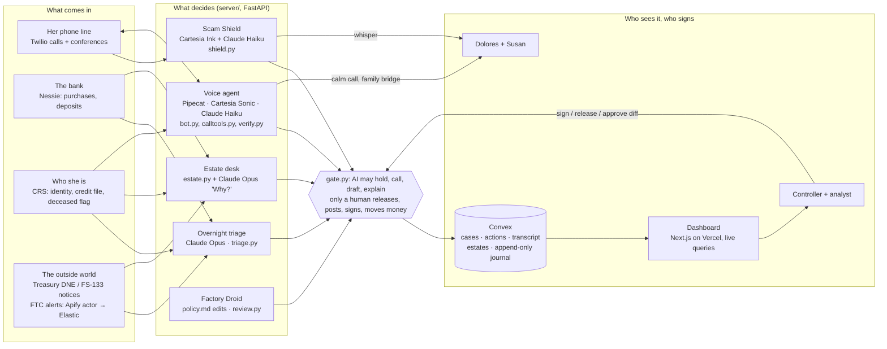

# Architecture

**The three beats on this map**
1. **The fake collector:** Phone → Scam Shield → whisper to Dolores. The 24-hour hold on gift cards goes through the gate.
2. **Harold's books:** Nessie deposits, CRS and Treasury notices → estate desk → gate → Convex journal → the controller signs.
3. **The calm call:** voice agent ↔ Dolores, verified from CRS, with an offer to bridge Susan.
